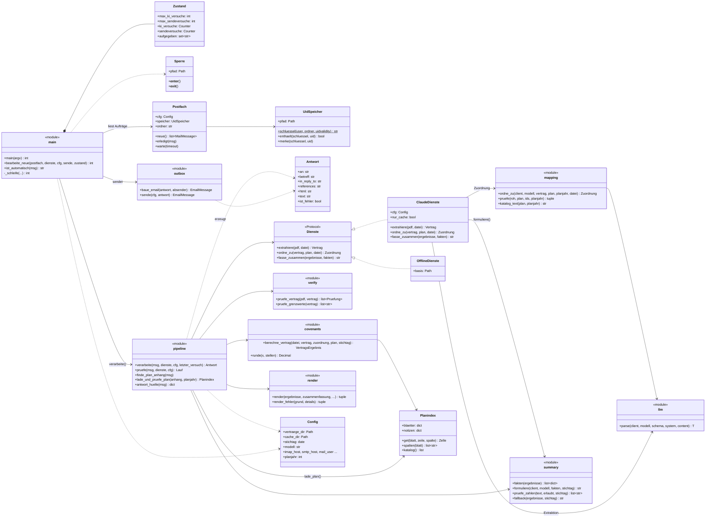
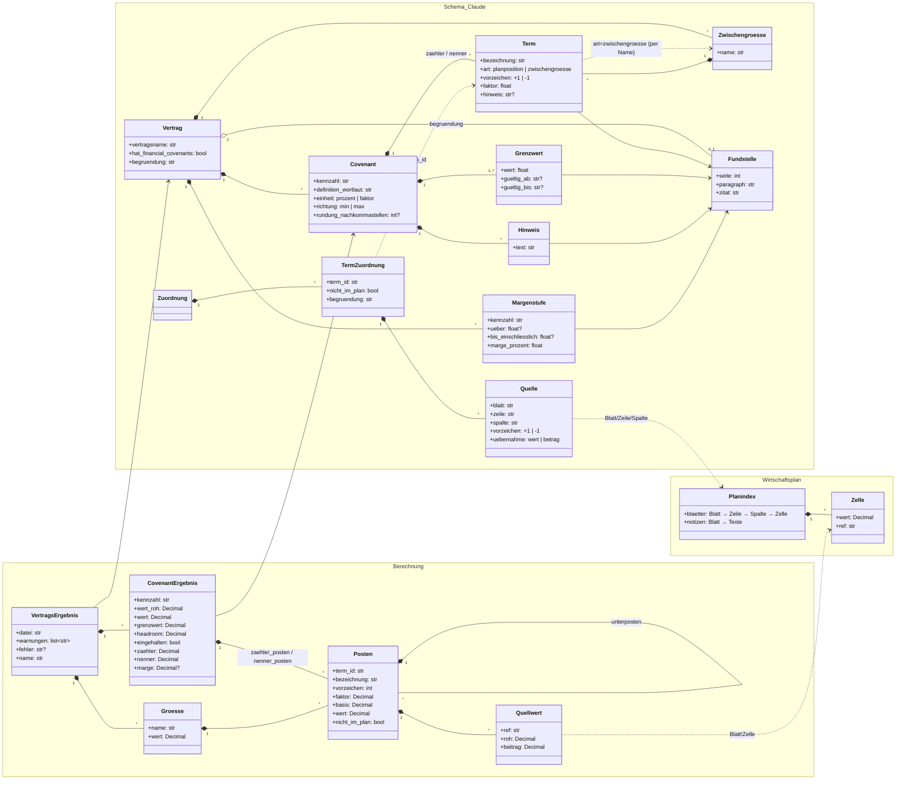
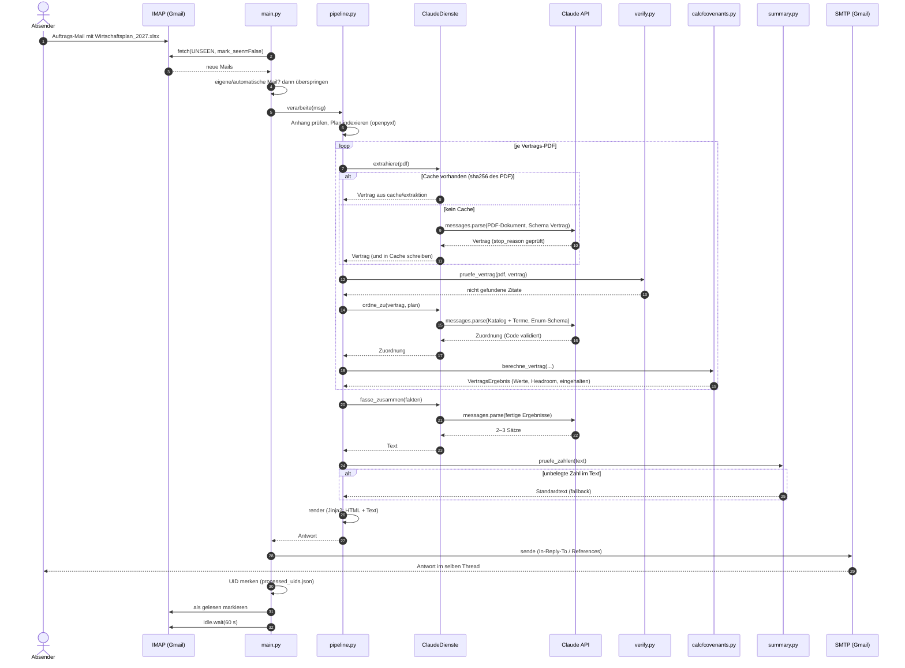

# UML – Finn

Drei Sichten auf das System. GitHub rendert die Mermaid-Blöcke direkt; lokal z. B. mit dem
Mermaid-Plugin in PyCharm.

1. **Komponenten** – wer mit wem arbeitet (Pipeline, Dienste, Mail)
2. **Datenmodell** – was Claude liefert (Schema) und was der Code daraus berechnet
3. **Ablauf** – Sequenz einer Auftrags-Mail bis zur Antwort

## 1. Komponenten (Klassendiagramm)

Module ohne eigene Klasse sind als `<<module>>` mit ihren öffentlichen Funktionen dargestellt.

## 2. Datenmodell (Klassendiagramm)

Links das Pydantic-Schema, das Claude befüllt (nur Struktur, Wortlaut, Fundstellen – keine
berechneten Werte). Rechts die Ergebnisse, die `calc/covenants.py` daraus berechnet.

## 3. Ablauf einer Auftrags-Mail (Sequenzdiagramm)

